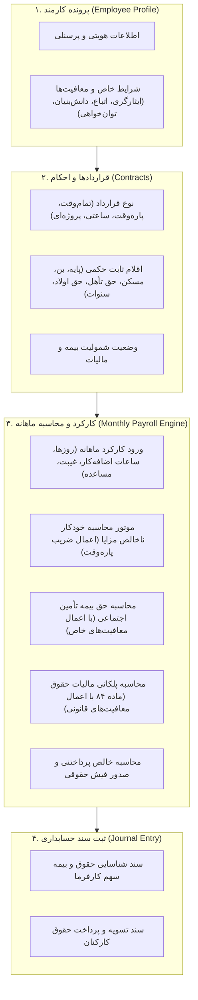

# سند مشخصات فنی و معماری ماژول حقوق و دستمزد، قراردادها و کارکنان

این سند، مشخصات و قواعد پیاده‌سازی ماژول سه‌گانه **کارمندان (Employees)**، **قراردادها (Contracts)** و **حقوق و دستمزد (Payroll)** را همراه با قوانین به‌روز کار، مالیات‌های مستقیم و تأمین اجتماعی تعیین می‌کند.

---

## ۱. دیاگرام جریان و ارتباط موجودیت‌ها

---

## ۲. مشخصات و فیلدهای موجودیت‌ها

### ۲.۱. موجودیت کارمند (Employee)
* **شناسه‌های اصلی:**
  * کد پرسنلی (`employee_code` - یکتا در سطح شرکت)
  * نام و نام خانوادگی (`first_name`, `last_name`)
  * نوع هویت و شماره:
    * پرسنل ایرانی: کد ملی (`national_id` - ۱۰ رقمی با اعتبارسنجی الگوریتم کنترل)
    * اتباع خارجی: کد فراگیر اتباع (`foreign_national_id`)
  * شماره شناسنامه، تاریخ تولد، تاریخ استخدام (`hire_date`)
  * شماره بیمه تأمین اجتماعی (`insurance_number`)
  * اطلاعات بانکی: شماره شبا (`iban` - ۲۴ رقمی IR)، شماره حساب و نام بانک
* **اطلاعات خانوادگی و سنواتی:**
  * وضعیت تأهل (`marital_status`: مجرد، متأهل)
  * تعداد فرزندان (`children_count` - جهت محاسبه حق اولاد)
  * سابقه کار قبلی در کارگاه (جهت محاسبه پایه سنوات)
* **شرایط و پرچم‌های معافیت قانونی (Special Conditions):**
  * `is_veteran_or_child`: ایثارگر، جانباز، یا فرزند شاهد و جانباز (ماده ۵۶)
  * `is_foreign_national`: تبعه خارجی (حذف بیمه بیکاری)
  * `is_science_park_staff`: شاغل در پارک علم و فناوری / دانش‌بنیان (ماده ۱۰ جهش تولید)
  * `has_disability_charge`: سرپرست فرد دارای معلولیت شدید (ماده ۲۵ حمایت از معلولان)
  * `is_underdeveloped_region`: شاغل در مناطق محروم و کمتر توسعه‌یافته (ماده ۹۲ ق.م.م)
  * `is_retired`: بازنشسته شاغل

---

### ۲.۲. موجودیت قرارداد / حکم (Contract)
* **اطلاعات پایه قرارداد:**
  * ارجاع به کارمند (`employee_id`)
  * شماره و تاریخ قرارداد (`contract_number`, `contract_date`)
  * تاریخ شروع و تاریخ پایان (`start_date`, `end_date`)
  * وضعیت: فعال (`active`)، خاتمه‌یافته (`terminated`)، پیش‌نویس (`draft`)
* **نوع قرارداد (`contract_type`):**
  * `full_time`: تمام‌وقت (مبنای قانون کار: ۴۴ ساعت در هفته / ۳۰ یا ۳۱ روز در ماه)
  * `part_time`: پاره‌وقت (مبنای ماده ۳۹ قانون کار: محاسبه حقوق، مزایا و بیمه به نسبت ساعات کارکرد)
  * `hourly`: ساعتی (نرخ مشخص به ازای هر ساعت کار)
  * `project`: پروژه‌ای / مشاوره‌ای (مبلغ مقطوع یا مرحله‌ای، مالیات تکلیفی ماده ۸۶)
* **اقلام ریالی حکم:**
  * حقوق پایه ماهانه یا روزانه (`base_salary`)
  * کمک‌هزینه مسکن (`housing_allowance`)
  * کمک‌هزینه اقلام مصرفی / بن کارگری (`grocery_allowance`)
  * حق تأهل (`marital_allowance`)
  * حق اولاد ماهانه (`child_allowance` - محاسبه خودکار یا دستی)
  * پایه سنوات روزانه/ماهانه (`tenure_allowance`)
  * حق سرپرستی / جذب / سایر مزایای مستمر (`custom_fixed_allowances`)
* **قواعد شمولیت:**
  * مشمول بیمه تأمین اجتماعی (`is_insured`: بلی/خیر)
  * مشمول مالیات حقوق (`is_taxable`: بلی/خیر)

---

### ۲.۳. کارکرد و فیش ماهانه (Monthly Timesheet & Payslip)
* **ورودی کارکرد ماه:**
  * ماه و دوره مالی (`period_id`, `year`, `month`)
  * روزهای کارکرد موثر (`work_days` - از ۳۰ یا ۳۱ روز)
  * ساعات کارکرد واقعی (به‌ویژه برای پاره‌وقت و ساعتی)
  * ساعات اضافه‌کاری (`overtime_hours`)
  * روزهای مرخصی (استحقاقی، استعلاجی، بدون حقوق)
  * کسورات متغیر این ماه: مساعده (`advance_payment`)، اقساط وام (`loan_installment`)، سایر کسورات

---

## ۳. ارقام و مصوبات به‌روز قانون کار و مالیات

### ۳.۱. جدول نرخ‌های مصوب شورای عالی کار (مبنای ریالی)
* **حداقل دستمزد روزانه:** ۲,۳۸۸,۷۲۸ ریال
* **حداقل حقوق ماهانه ۳۰ روزه:** ۷۱,۶۶۱,۸۴۰ ریال (۳۱ روزه: ۷۴,۰۵۰,۵۶۸ ریال)
* **بن کارگری (اقلام مصرفی):** ۱۴,۰۰۰,۰۰۰ ریال ماهانه
* **حق مسکن:** ۹,۰۰۰,۰۰۰ ریال ماهانه
* **حق تأهل:** ۵,۰۰۰,۰۰۰ ریال ماهانه (برای کارگران متأهل اعم از زن یا مرد)
* **حق اولاد:** معادل ۳ روز حداقل دستمزد روزانه به ازای هر فرزند = ۷,۱۶۶,۱۸۴ ریال (بدون محدودیت سقف تعداد فرزند)
* **پایه سنوات:** روزانه ۷۰,۰۰۰ ریال (ماهانه ۲,۱۰۰,۰۰۰ ریال برای ۳۰ روز) برای سابقه بیش از یک سال
* **فوق‌العاده اضافه‌کاری:** ۴۰٪ فوق‌العاده بر مزد ساعت عادی (ضریب ۱.۴):
  $$\text{نرخ هر ساعت عادی} = \frac{\text{مزد ماهانه}}{۲۲۰} \quad \text{یا} \quad \frac{\text{مزد روزانه}}{۷.۳۳}$$
  $$\text{مبلغ اضافه کاری} = \text{ساعات اضافه‌کار} \times \text{نرخ ساعت عادی} \times ۱.۴$$

---

### ۳.۲. جدول پله‌های مالیاتی حقوق (ماده ۸۴ قانون مالیات‌های مستقیم و قانون بودجه)
* **سقف معافیت سالانه:** ۱,۴۴۰,۰۰۰,۰۰۰ ریال (معادل ۱۲ میلیون تومان در ماه معاف)

| پله | محدوده درآمد مشمول مالیات ماهانه (تومان) | نرخ مالیات | فرمول محاسبه مالیات پله |
| :---: | :--- | :---: | :--- |
| **۱** | تا ۱۲,۰۰۰,۰۰۰ تومان | **معاف (۰٪)** | ۰ |
| **۲** | مازاد ۱۲,۰۰۰,۰۰۰ تا ۱۶,۵۰۰,۰۰۰ تومان | **۱۰٪** | $\Delta \text{درآمد} \times ۰.۱۰$ |
| **۳** | مازاد ۱۶,۵۰۰,۰۰۰ تا ۲۷,۰۰۰,۰۰۰ تومان | **۱۵٪** | $\Delta \text{درآمد} \times ۰.۱۵$ |
| **۴** | مازاد ۲۷,۰۰۰,۰۰۰ تا ۴۰,۰۰۰,۰۰۰ تومان | **۲۰٪** | $\Delta \text{درآمد} \times ۰.۲۰$ |
| **۵** | مازاد بر ۴۰,۰۰۰,۰۰۰ تومان | **۳۰٪** | $\Delta \text{درآمد} \times ۰.۳۰$ |

> **معافیت سهم بیمه کارمند از مالیات:** طبق بخشنامه سازمان امور مالیاتی و ماده ۱۳۷ ق.م.م، دو هفتم از سهم بیمه پرداختی کارمند (۲/۷ از ۷ درصد) از درآمد مشمول مالیات کسر می‌شود.

---

## ۴. استنادهای قانونی و فرمول‌های شرایط ویژه

### ۱. ایثارگران، جانبازان و فرزندان شاهد (ماده ۵۶ قانون جامع خدمات‌رسانی به ایثارگران)
* **معافیت مالیاتی ۱۰۰٪:** به موجب ماده ۵۶، کلیه حقوق و مزایای دریافتی جانبازان، آزادگان و فرزندان شاهد و جانبازان از پرداخت مالیات بر درآمد حقوق به‌طور کامل معاف است ($\text{مالیات} = ۰$).
* **معافیت ۷٪ بیمه سهم کارمند:** طبق بخشنامه‌های سازمان تأمین اجتماعی و بنیاد شهید، ۷ درصد حق بیمه سهم کارگر توسط دولت پرداخت می‌شود و از حقوق کارگر کسر نمی‌گردد ($\text{بیمه سهم کارمند} = ۰$).

### ۲. کارکنان شرکت‌های مستقر در پارک‌های علم و فناوری (قانون جهش تولید دانش‌بنیان)
* **مستند قانونی:** بند «چ» ماده ۸ قانون جهش تولید دانش‌بنیان (ماده ۱۰ اصلاحی قانون حمایت از دانش‌بنیان‌ها).
* **قاعده مالیاتی:** حقوق پرسنل شاغل در پارک علم و فناوری مشمول ماده ۹۱ ق.م.م (نرخ صفر / معافیت کامل مالیاتی) است ($\text{مالیات} = ۰$).

### ۳. اتباع خارجی شاغل (Foreign Nationals)
* **مستند قانونی:** قانون تأمین اجتماعی و آیین‌نامه اشتغال اتباع خارجی.
* **نرخ بیمه اجباری:** اتباع خارجی مشمول ۳٪ بیمه بیکاری نمی‌شوند. بنابراین:
  * سهم کارمند: ۷٪
  * سهم کارفرما: ۲۰٪ (فاقد ۳٪ بیمه بیکاری)
  * مجموع حق بیمه پرداختی به سازمان: **۲۷ درصد** (به جای ۳۰ درصد).

### ۴. افراد دارای معلولیت و اولیای آنان (ماده ۲۵ قانون حمایت از حقوق معلولان)
* **مستند قانونی:** ماده ۲۵ قانون حمایت از حقوق معلولان (مصوب ۱۳۹۶).
* **قاعده مالیاتی:** ۵۰ درصد از حقوق و مزایای مشمول مالیات یکی از اولیای افراد دارای معلولیت شدید و خیلی شدید معاف از مالیات است:
  $$\text{درآمد مشمول مالیات نهایی} = \text{درآمد مشمول} \times ۰.۵۰$$

### ۵. شاغلین در مناطق محروم و کمتر توسعه‌یافته (ماده ۹۲ ق.م.م)
* **قاعده مالیاتی:** ۵۰ درصد تخفیف بر مالیات محاسبه‌شده حقوق اعمال می‌شود:
  $$\text{مالیات نهایی} = \text{مالیات محاسبه‌شده} \times ۰.۵۰$$

### ۶. قراردادهای پاره‌وقت (ماده ۳۹ قانون کار)
* **قاعده تناسب:** کلیه اقلام ثابت حکم (حقوق پایه، بن، مسکن، سنوات، حق اولاد) و روزهای بیمه بر اساس نسبت ساعات کارکرد ماهانه به ساعات کارکرد موظفی ماه محاسبه می‌شوند:
  $$\text{ضریب کارکرد} = \frac{\text{ساعات کارکرد واقعی ماه}}{۲۲۰}$$
  $$\text{مبلغ هر قلم مزایا} = \text{مبلغ ماهانه در حکم} \times \text{ضریب کارکرد}$$
  $$\text{روزهای کارکرد بیمه} = \min\left(۳۰, \frac{\text{ساعات کارکرد}}{۷.۳۳}\right)$$

---

## ۵. چرخه سند حسابداری دوبل

در پایان دوره پس از نهایی‌سازی محاسبات ماه، سند حسابداری به شرح زیر صادر می‌شود:

### سند شناسایی حقوق و دستمزد ماهانه:
* **بدهکار:** هزینه حقوق و دستمزد (`salary_expense`) $\rightarrow$ ناخالص کل مزایا
* **بدهکار:** هزینه بیمه سهم کارفرما (`employer_insurance_expense`) $\rightarrow$ ۲۰٪ یا ۲۳٪
* **بستانکار:** حقوق پرداختنی (`payroll_payable`) $\rightarrow$ خالص پرداختی کارمندان
* **بستانکار:** بیمه پرداختنی (`insurance_payable`) $\rightarrow$ مجموع سهم کارمند و کارفرما (۳۰٪ یا ۲۷٪)
* **بستانکار:** مالیات حقوق پرداختنی (`payroll_tax_payable`) $\rightarrow$ مالیات تکلیفی حقوق
* **بستانکار:** سایر کسورات پرداختنی (`other_deductions_payable`) $\rightarrow$ مساعده، وام و...

### سند تسویه و پرداخت حقوق:
* **بدهکار:** حقوق پرداختنی (`payroll_payable`)
* **بستانکار:** بانک (`bank_a`)
