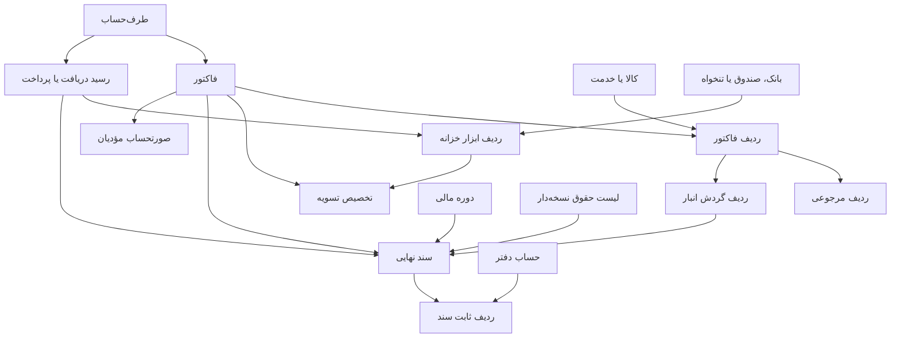

# ممیزی موجودیت‌های حسابداری دیدبان مالی

۲۵ نوامبر ۲۰۲۶ · مبنا نسخهٔ کاری فعلی روی `main` در کنار تغییرات ثبت‌نشدهٔ کدینگ است. دامنه، کل پروژه در سطح زیرسامانه و بررسی عمیق CRUD و روابط موجودیت‌های مالی است. فهرست مرجع شامل ۱۲۰ جدول و OpenAPI جاری شامل ۲۶۰ مسیر و ۳۱۷ عملیات HTTP است. جدول‌های ثبت رویداد، شواهد، تأیید و خروجی ثابت در دامنه بررسی شدند و چرخهٔ داده‌های اصلی برایشان معیار مناسبی نیست. [فهرست موجودیت‌ها](../docs/entity-inventory.fa.md) · [OpenAPI](../contracts/openapi.json) · [DDL](../database/schema.sql)

**نتیجه.** بیشترین ریسک فعلی در خروجی دفاتر، صحت تاریخی حقوق، چرخهٔ فاکتور و مرجوعی و هویت مشترک طرف‌حساب و خزانه است. چهار گروه خطا با دادهٔ ساختگی بازتولید شد. محدودیت‌های مصوب همچون ریال در رابط، یک دفتر اصلی، FIFO، تعداد صحیح در پایلوت و عدم عرضهٔ قابلیت‌های گروهی در ارزیابی رعایت شده‌اند. پیشنهادهای ساختاری زیر تصمیم محصول محسوب نمی‌شوند. [تصمیم‌های پروژه](../docs/advanced-capabilities-decisions.fa.md)

## یافته‌های بازتولیدشده

| اولویت | موجودیت یا خروجی | رفتار بازتولیدشده | تغییر موردنیاز |
|---|---|---|---|
| بحرانی | سند نهایی و دفاتر الکترونیکی | سندی با مبلغ ۱۰۰ در ماه اول و سند برگشت آن در ماه دوم، خروجی ماه اول را خالی کرد. خروجی تا ماه دوم فقط برگشت را نشان داد. شناسه‌های برگشت‌خورده پیش از اعمال محدودهٔ تاریخ پیدا می‌شوند و فقط اصل از خروجی حذف می‌شود. | دفتر گردش باید اصل و برگشت را به تاریخ هر کدام نشان دهد. نمای مانده پس از اصلاح، معنای مستقل و تاریخ برش صریح داشته باشد. [سرویس دفتر](../apps/api/didban/electronic_ledgers_service.py#L45) |
| مهم | حساب و سلسله‌مراتب | در ارتقای سه‌به‌چهار سطح، ریشه با کد تاریخی `100` به گروه تبدیل شد. ویرایش آن با `invalid_account_code_pattern` رد شد. تولید خودکار زیر همین گروه کد `10001` داد که اعتبارسنج چهاررقمی کل رد می‌کند. | وضعیت کد قدیمی را صریح ثبت کنید. ایجاد و تولید خودکار از یک اعتبارسنج استفاده کنند. پیش از تغییر طبقه‌بندی تاریخی، نگاشت کنترل‌شده و سازگاری ویرایش حساب‌های قدیمی بررسی شود. [ارتقا](../apps/api/didban/db.py#L337) · [اعتبارسنج و تولید کد](../apps/api/didban/account_catalogue_service.py#L205) |
| مهم | دورهٔ مالی و رویداد چک | برای دوره‌ای با چک ثبت‌شده، تابع وابستگی مقدار false برگرداند و حذف دوره موفق شد. رویداد، شناسهٔ دورهٔ حذف‌شده را نگه داشت. برای دورهٔ مقایسه، گارد هم وابستگی را ندید اما کلید خارجی پایگاه حذف را متوقف کرد. | وابستگی در CRUD و DDL هم‌راستا باشد. برای رویداد چک، رابطهٔ مرکب شرکت و دوره تعریف و حذف یا تغییر بازهٔ استفاده‌شده در سرویس متوقف شود. وابستگی دورهٔ مقایسه از ابتدا در `in_use` دیده شود. [گارد حذف](../apps/api/didban/services.py#L329) · [مدل رویداد چک](../apps/api/didban/cheque_models.py#L33) · [DDL دوره](../database/schema.sql#L334) |
| مهم | کارمند و قرارداد کار | هر دو درخواست PATCH با نسخهٔ صحیح به HTTP 500 می‌رسند. سرویس عدد نسخه را به `check_version` می‌دهد، در حالی که تابع شیء نسخه‌دار می‌گیرد. مسیر HTTP همواره نسخه را می‌فرستد و آزمون فعلی ویرایش سرویس بدون نسخه را صدا می‌زند. | شیء کارمند یا قرارداد را به کنترل نسخه بدهید. ویرایش نسخهٔ جاری و رد نسخهٔ قدیمی در هر دو مسیر HTTP آزموده شوند. پاک‌کردن فیلدهای اختیاری نیز باید از ارسال‌نکردن فیلد تفکیک شود. [کارمند](../apps/api/didban/payroll_service.py#L252) · [قرارداد](../apps/api/didban/payroll_service.py#L408) · [API](../apps/api/didban/routes/payroll_routes.py#L57) |

## دفتر، کدینگ و دوره

- **دفاتر تجاری الکترونیکی.** خروجی Excel یک نمای گروه‌بندی‌شدهٔ کل یا معین است. ستون‌های جداگانهٔ کل و معین در همان ردیف، ترتیب قالب و شناسهٔ اجرای ثابت ندارد. مانده با صفر از ابتدای فیلتر شروع می‌شود و شمارهٔ روزانه با تغییر محدودهٔ تاریخ دوباره از ۱ محاسبه می‌شود. حساب و سلسله‌مراتب هم از دادهٔ جاری خوانده می‌شوند و تغییر طبقه‌بندی می‌تواند گزارش تاریخی را جابه‌جا کند. استفاده از `Number` در Excel نیز مبلغ بزرگ را تغییر می‌دهد. نمونهٔ `9007199254740993` به `9007199254740992` تبدیل می‌شود. برای فایل رسمی، نگاشت نسخه‌دار کل/معین، دوره یا سال مالی، تاریخ برش، قالب اعلامی و کنترل دقت و جمع لازم است. گزارش مدیریتی می‌تواند خروجی جداگانه داشته باشد. [سرویس](../apps/api/didban/electronic_ledgers_service.py#L71) · [خروجی وب](../apps/web/components/workspace/electronic-ledgers-view.tsx#L92) · [راهنمای سازمان امور مالیاتی](https://worldofacc.com/wp-content/uploads/2025/06/%D8%B1%D8%A7%D9%87%D9%86%D9%85%D8%A7%DB%8C-%D8%B3%D8%A7%D9%85%D8%A7%D9%86%D9%87-%D8%AF%D9%81%D8%A7%D8%AA%D8%B1-%D8%AA%D8%AC%D8%A7%D8%B1%DB%8C-%D8%A7%D9%84%DA%A9%D8%AA%D8%B1%D9%88%D9%86%DB%8C%DA%A9.pdf#page=5)
- **سند و ردیف سند.** `Draft.lines` و `NativeJournal.snapshot` آرایه‌اند و `JournalLine` متعلق به مسیر دادهٔ ورودی است. در دفتر بومی شناسهٔ ردیف قابل ارجاع از یک جدول مستقل وجود ندارد و نمونهٔ تخصیص بومی با `journal_id + line_index` ردیف را پیدا می‌کند. این مدل نگهداری snapshot تأیید را پوشش می‌دهد ولی رابطهٔ الزام‌آور ردیف با حساب، شناسهٔ طرف، ردیف فاکتور، رسید و بُعد را در پایگاه محدود می‌کند. پیشنهاد، افزودن ردیف ثابت با شناسه و کلیدهای مرکب شرکت در کنار snapshot فعلی، با حفظ تأیید نسخهٔ دقیق، برگشت و جایگزینی است. شرح ردیف و مرجع جزئی نیز در CRUD صریح شوند. [پیش‌نویس](../apps/api/didban/accounting_models.py#L36) · [سند](../apps/api/didban/posting_models.py#L11) · [تخصیص بومی](../apps/api/didban/dimensions_models.py#L49)
- **حساب، کدینگ و تفصیلی.** درخت چهارسطحی و طول ۲/۴/۶/۸ تا ۱۲ تصمیم طراحی‌اند. راهنمای دفاتر فیلدهای کل و معین را مشخص می‌کند و الزام همگانی به این طول‌ها یا یک درخت ثابت از آن استنباط نمی‌شود. تفصیلی شناور برای استفاده از یک شخص در چند معین، با نگاشت `حساب معین ↔ تفصیلی مجاز` و شناسهٔ شخص قابل پیاده‌سازی است. فیلد `nature=floating` به‌تنهایی این رابطه را برقرار نمی‌کند. `NativeAccountRole` هم یک نقش جاری دارد. مسیر ویرایش حساب برای نقش، رشتهٔ ورودی را مستقیماً ذخیره می‌کند. برای نقش‌های اثرگذار بر گزارش، همان فهرست معتبر و کنترل تغییر باید در تمام مسیرها اعمال شود. [ساختار حساب](../apps/api/didban/accounting_models.py#L11) · [ثبت نقش از فرم حساب](../apps/api/didban/accounting_service.py#L84) · [نقش گزارش](../apps/api/didban/native_reporting_models.py#L8)
- **دوره و شماره‌گذاری.** CRUD، کنترل هم‌پوشانی، قفل، بازگشایی و اسناد دوره موجودند. اگر شرکت گزارش ماهانه درون سال مالی و ارسال دفاتر همان سال می‌خواهد، بازهٔ گزارش را از موجودیت سال/دورهٔ مجاز ثبت جدا کنید. شماره‌گذاری موجود بر شرکت و نوع موجودیت یکتاست. شمارهٔ ثابت سند، شمارهٔ داخلی گردش و شمارهٔ مالیاتی سه شناسه با مراجع متفاوت‌اند و باید جدا بمانند. شروع دوبارهٔ شماره بر مبنای سال یک تصمیم اجرایی است که مدل فعلی شماره‌گذاری کلید مستقلی برای آن ندارد. [دوره](../apps/api/didban/routes/periods.py) · [شماره‌گذاری](../apps/api/didban/numbering_models.py)

## طرف‌حساب، خرید و فروش و تسویه

| موجودیت | فیلد و چرخهٔ فعلی | رابطه و تغییر موردنیاز |
|---|---|---|
| طرف‌حساب `CommercialCounterparty` | نام، کد، یک نوع از چهار مقدار، شناسهٔ ملی، کد اقتصادی، تماس، نشانی، حد اعتبار و وضعیت فعال. فرم ایجاد/ویرایش و غیرفعال‌سازی وجود دارد. | حقیقی/حقوقی/سایر و نقش‌های تجاری مستقل باشند. یک شخص بتواند هم مشتری و هم تأمین‌کننده باشد. برای صدور صورتحساب، هویت و نشانی معتبر در زمان صدور ثابت شود. از شناسهٔ مرجع واحد در ردیف سند، فاکتور، تسویه و چک استفاده شود. تطبیق تجاری کد و ID را می‌پذیرد، اما تخصیص بومی رشتهٔ خام `party_id` را مقایسه می‌کند. ثبت یک طرف با کد در فاکتور و ID در دریافت می‌تواند تخصیص را رد کند. دادهٔ وارداتی شناسهٔ خارجی و نگاشت مستقل خود را حفظ کند. [کارت](../apps/api/didban/commercial_models.py#L19) · [حل هویت](../apps/api/didban/commercial_service.py#L122) · [تخصیص](../apps/api/didban/native_invoice_service.py#L356) |
| پیش‌فاکتور `ProformaInvoice` | شماره، تاریخ، انقضا، طرف، اقلام JSON، جمع، شرایط و وضعیت. تبدیل فعلی یک قلم کالایی بدون تخفیف را می‌پذیرد. سرویس لغو تعریف شده و در CRUD عمومی مسیر لغو ندارد. | ارتباط هر ردیف با ردیف فاکتور مقصد لازم است. وضعیت به‌محض ایجاد پیش‌نویس به `converted` می‌رود. کنارگذاشتن پیش‌نویس وضعیت پیش‌فاکتور را بازیابی نمی‌کند، بنابراین مسیر تبدیل مجدد از دست می‌رود. تبدیل در انتظار ثبت، تبدیل نهایی و انصراف باید در یک چرخهٔ قابل ممیزی قرار گیرند. [مدل](../apps/api/didban/commercial_models.py#L37) · [تبدیل](../apps/api/didban/commercial_service.py#L444) · [کنارگذاری](../apps/api/didban/posting_service.py#L519) |
| فاکتور خرید و فروش بومی `NativeInvoice` | از یک عملیات دارای سند ثبت‌شده ساخته می‌شود. اصل تجاری در `source` و شرایط و اصلاح مرجع در نسخه‌های جدا ذخیره می‌شوند. | موجودیت سربرگ و اقلام تجاری مستقل نیاز است. شماره داخلی و شماره فروشنده، تاریخ صدور و تاریخ ثبت، شناسهٔ طرف، کالا/خدمت، مقدار و واحد، قیمت، تخفیف ردیف و سهم تخفیف کل، مالیات در دامنه مصوب، شرایط تسویه و جمع دقیق را ثبت کند. جریان پیشنهادی از پیش‌نویس تجاری به ثبت هماهنگ مانده، انبار و سند می‌رسد و نسخهٔ نهایی ثابتی می‌سازد. یک ردیف می‌تواند مرجع مرجوعی جزئی و گردش انبار باشد. فاکتور وارداتی همچنان مدرک خارجی است. [مدل](../apps/api/didban/native_invoice_models.py#L12) · [CRUD](../apps/api/didban/routes/native_invoices.py) · [ساخت از سند](../apps/api/didban/native_invoice_service.py#L295) |
| برگشت و اعتبار تجاری | گردش جایگزین سند و فاکتور موجود است. مرجوعی جزئی چندقلمی و اعتبار مستقل در پایلوت بازند. | `ردیف مرجوعی → ردیف فاکتور اصلی → گردش یا لایهٔ بهای اولیه` و `اعتبار → طرف‌حساب و فاکتور` ثبت شوند. فاکتور با مانده، ابتدا کاهش مانده و سپس اعتبار بابت مازاد دارد. مرجوعی فروش تسویه‌شده اعتبار مشتری دارد. مرجوعی خرید طبق D29 حساب تأمین‌کننده و همان فاکتور را به هم وصل می‌کند. [تصمیم‌های D24 تا D34](../docs/current-implementation.fa.md#تصمیمهای-جدید-برای-خرید-و-فروش-چندقلمی) |
| دریافت، پرداخت و تسویه | عملیات و سند، واردات گردش بانک و تخصیص‌های نسخه‌دار بومی/وارداتی در مسیرهای جدا هستند. | یک رسید دریافت/پرداخت تجاری با ردیف ابزار (نقد، بانک، چک یا سایر ابزار مجاز)، طرف، تاریخ، مرجع و رابطه با سند لازم است. تسویه باید به ردیف ابزار یا ثبت مالی واقعی متصل باشد و بتواند چند فاکتور را در سقف واقعی پوشش دهد. سازوکار موجود کنترل مبلغ و ثبت برگشت حفظ شود. [عملیات](../apps/api/didban/operation_models.py#L9) · [روابط تسویه بومی](../apps/api/didban/native_invoice_models.py#L43) |

## خزانه و انبار

- **بانک، صندوق و تنخواه.** فرم تعریف بانک شمارهٔ حساب و فرم صندوق/تنخواه نام مسئول می‌گیرد و هر دو را در متن `name` حساب دفتر می‌چسباند. CRUD مستقل و رابطهٔ بانکی قابل استفاده برای تطبیق یا چک شکل نمی‌گیرد. مدل خزانه باید به حساب دفتر متصل شود و شماره‌حساب، شبا و شعبه برای بانک، و مسئول و در صورت نیاز سقف برای تنخواه را در فیلد مستقل نگه دارد. غیرفعال‌سازی، سابقهٔ گردش را حفظ کند. [ارسال فرم خزانه](../apps/web/components/workspace/treasury-account-drawer.tsx#L157)
- **چک و رویداد چک.** `number` با طول ۱ تا ۱۰۰ وجود دارد، اما شناسهٔ صیادی مستقل، هویت دارنده/انتقال‌گیرنده و مرجع تأیید صیاد در مدل وجود ندارد. `bank_account`، `party_id` و `endorsed_to` متن‌اند. `ChequeEvent` وضعیت و علت را نگه می‌دارد ولی شخص منتقل‌الیه در خود رویداد ذخیره نمی‌شود. `ChequeClearance.event_id` رابطهٔ خارجی با رویداد ندارد. وضعیت بانکی یا صیادی هم نباید از وضعیت داخلی نتیجه گرفته شود. پیشنهاد، پیوند برگه، هویت دارنده، ابزار خزانه، رخداد و مدرک گردش است. برای اثر حسابداری، پیش‌نویس سند وابسته به رویداد و با تأیید دقیق صادر شود. [مدل](../apps/api/didban/cheque_models.py) · [چرخه](../apps/api/didban/cheque_service.py#L156) · [ماده ۲۱ مکرر قانون صدور چک](https://lawlex.ir/laws/chek/21-mokarrar)
- **کالا/خدمت و انبار.** کالا کد، نام، حساب موجودی و وضعیت دارد. انبار کد، نام و وضعیت دارد. ورودی گردش، مقدار صحیح و یک کالا در هر عملیات می‌پذیرد. برای مقدار صحیح پایلوت هم واحد پایه باید مشخص باشد، زیرا عدد ۲ بدون واحد قابل تفسیر نیست. کاتالوگ کالا/خدمت، واحد و شناسهٔ مالیاتی قابل نسخه‌بندی لازم دارد. خدمت رفتار گردش موجودی ندارد. گروه کالا، واحدهای تبدیل و بارکد تابع نیاز واقعی کسب‌وکارند. ارتباط شعبه/محل و مسئول انبار نیز در صورت نیاز عملیاتی اضافه شود. [کالا و انبار](../apps/api/didban/inventory_models.py#L22) · [ورودی انبار](../apps/api/didban/inventory_schemas.py)
- **گردش انبار و ارزش‌گذاری.** افتتاح، انتقال، تعدیل و FIFO برقرار است. قید یکتایی روی `company_id, journal_id, warehouse_id, kind` حتی دو کالای متفاوت با یک نوع حرکت در همان انبار و سند را نمی‌پذیرد. برای فاکتور چندقلمی، هویت ردیف گردش و رابطهٔ آن با قلم فاکتور و لایهٔ بهای FIFO لازم است. برای ارزش دفتری، سند مستقل ارزیابی خالص ارزش فروش، کاهش ارزش و برگشت آن باید بتواند مقدار را ثابت بگذارد. تعدیل تعدادی فعلی مقدار غیرصفر می‌خواهد. هزینه‌های رساندن کالا به مکان و وضعیت فعلی نیز باید در بهای قابل تخصیص قابل ردیابی باشند. [قید گردش](../apps/api/didban/inventory_models.py#L49) · [ارزش‌گذاری فعلی](../apps/api/didban/inventory_service.py#L1212) · [استاندارد حسابداری شماره ۸، بندهای ۴، ۶، ۳۶ و ۳۸](https://hesabgaranpishtaz.ir/wp-content/uploads/2023/12/8.pdf)

## کارکنان، حقوق و مؤدیان

- **کارمند، قرارداد و کارگاه.** کارمند اطلاعات هویت، بانک، بیمه و وضعیت فردی دارد. قرارداد به کارمند وصل است و دوره و اجزای ثابت حقوق دارد. برای اینکه رکورد قرارداد نمایندهٔ قرارداد کار باشد، نوع کار و محل انجام کار، ساعات و تعطیلات، تاریخ انعقاد مستقل از شروع، شرایط مربوط به نوع قرارداد و نسخه یا الحاقیه لازم است. عنوان شغلی جاری روی کارمند جایگزین تاریخچهٔ قرارداد نمی‌شود. کارگاه و کد بیمه، گروه یا فهرست بیمه و اطلاعات کارفرما باید موجودیت/پروفایل مستقل داشته باشند. [مدل قرارداد](../apps/api/didban/payroll_models.py#L60) · [ماده ۱۰ قانون کار](https://faolex.fao.org/docs/pdf/ira158844.pdf#page=2)
- **لیست حقوق، فیش و کارکرد.** سال/ماه در لیست ثبت می‌شود ولی موتور نرخ‌های مبنای ۱۴۰۳ را از ثابت‌ها می‌خواند. کارمند مشغول و قرارداد معتبر در یک روز مرجع انتخاب می‌شوند و کارکرد اولیه برای تمام روزهای ماه پر می‌شود. این پیش‌فرض می‌تواند مبلغ ماه شروع یا خاتمه و تغییر قرارداد میان‌ماه را جابه‌جا کند. اصلاح کارکرد قرارداد و اطلاعات فعلی کارمند را دوباره می‌خواند. لازم است کارکرد واقعی مبنا باشد و فیش نسخهٔ قرارداد، وضعیت فردی مؤثر، اقلام مزایا/کسورات، پارامتر قانونی مؤثر و نتیجهٔ محاسبه را تثبیت کند. ارتباط با سند حقوق برقرار است و به رابطهٔ پرداخت فیش/تسویه و چرخهٔ لیست اصلاحی نیاز دارد. خواندن دادهٔ حساس و فایل‌های این حوزه با عضویت عمومی `read` در شرکت انجام می‌شود. اختیار مستقل مشاهده یا خروجی حقوق، تصمیم دسترسی لازم برای نصب عملیاتی است. [محاسبهٔ لیست](../apps/api/didban/payroll_service.py#L467) · [ثابت‌های موتور](../apps/api/didban/payroll_engine.py#L12) · [مسیرها](../apps/api/didban/routes/payroll_routes.py)
- **لیست بیمه و مالیات حقوق.** خروجی بیمه هنگام دانلود به اطلاعات جاری کارمند وصل می‌شود، از کد کارگاه `0000000000` و شناسه‌های پیش‌فرض استفاده می‌کند و خروجی بیمه و مالیات رشته‌های CSV هستند. شمارش بیمه در حلقه برای همهٔ ردیف‌ها افزایش می‌یابد، حتی ردیف‌های بدون درآمد مشمول. برای فایل عملیاتی، پروفایل واقعی کارگاه، کنترل اقلام الزامی، قلم‌های مشمول و نسخهٔ قالب، ثبت محتوای فایل ثابت و رابطهٔ فایل/لیست/فیش/رسید لازم‌اند. قالب قابل پذیرش در سامانه با نمونه و دورهٔ واقعی باید سنجیده شود. [بیمه](../apps/api/didban/payroll_service.py#L981) · [مالیات](../apps/api/didban/payroll_service.py#L1095)
- **صورتحساب مؤدیان.** ثبت و رویداد ارسال، دادهٔ ثابت و شناسهٔ مالیاتی دارند. فرم فعلی شناسهٔ کالا، واحد و هویت خریدار را دوباره به‌عنوان ورودی می‌گیرد و مدل ارسال فیلد موضوع صورتحساب و رابطهٔ صورتحساب مرجع ندارد. دامنهٔ موجود اصل نوع اول/فروش عمومی/تک‌قلم نسیه، معاف یا نرخ صفر است. برای شرکت مشمول و دامنهٔ کامل‌تر، نوع/الگو/موضوع و اقلام مالیاتی باید از نسخهٔ ثابت فاکتور و پروفایل ثبت‌شدهٔ فروشنده، خریدار و کالا ساخته شوند. اصلاحی، ابطالی و برگشت از فروش هر کدام هویت و پیوند مرجع مستقل دارند. وضعیت تجاری فاکتور، وضعیت ثبت سند و وضعیت سامانهٔ مؤدیان مستقل‌اند. [ورودی ارسال](../apps/api/didban/moadian_schemas.py#L15) · [مدل ارسال](../apps/api/didban/moadian_models.py#L9) · [دستورالعمل صادرهٔ سازمان، نسخهٔ منتشرشدهٔ آذر ۱۴۰۲، برای ساختار مرجع](https://acco.ir/wp-content/uploads/2023/12/%D8%B5%D9%88%D8%B1%D8%AA%D8%AD%D8%B3%D8%A7%D8%A8-%D8%A7%D9%84%DA%A9%D8%AA%D8%B1%D9%88%D9%86%DB%8C%DA%A9%DB%8C-%D8%A2%D8%B0%D8%B1-%DB%B1%DB%B4%DB%B0%DB%B2.pdf)

## حوزه‌های پشتیبان و اثر روابط پیشنهادی

| حوزه | نتیجهٔ مرور ساختار و CRUD |
|---|---|
| شرکت، اعضا، نقش‌ها | `Company` یک مرز مالکیت داده با نام و منطقهٔ زمانی است. اطلاعات ثبتی شرکت، شعبه، کارگاه، پروفایل مالیاتی و حساب بانکی باید به همین مرز وصل شوند و CRUD خود را داشته باشند. عضویت و مجوز ثبت سند/تأیید گزارش مستقل‌اند. [مدل پایه](../apps/api/didban/models.py#L76) · [CRUD شرکت](../apps/api/didban/routes/companies.py) |
| ابعاد، پروژه، شعبه و مرکز هزینه | ابعادِ هم‌نوع با کد و نام مدیریت می‌شوند. تخصیص به یک نسخهٔ منبع و ردیف آن وصل است. برای ثبت از مبدأ، پیوند به ردیف ثابت دفتر و اعتبارسنجی ابعاد مجاز هر حساب، در کنار تخصیص مدیریتی بعدی لازم است. شعبهٔ تحلیلی جای فیلدهای ثبتی شعبه یا کارگاه را پر نمی‌کند. [مدل](../apps/api/didban/dimensions_models.py) · [API](../apps/api/didban/dimensions_schemas.py) |
| ورود، آرشیو و تطبیق | فایل، ردیف، تفسیر، جلسه و نسخهٔ نتیجه باید به‌عنوان شواهد جدا بمانند. مدل‌های وارداتی فاکتور، گردش بانک، دفتر و کارکنان نباید خودکار جای پروفایل‌ها یا ثبت‌های بومی را بگیرند. پیوندهای نگاشت هویت، بانک و مبنا امکان تطبیق قابل توضیح را می‌دهند. [مدل شواهد](../apps/api/didban/models.py#L121) · [تطبیق طرف‌حساب](../apps/api/didban/counterparty_reconciliation_service.py) |
| گزارش، داشبورد و صورت مالی | گزارش/اجرا/تأیید و داشبورد ثابت نسخهٔ مستقل دارند. وابستگی به دوره، مبنا و نسخهٔ دفتر یا ورودی باید قابل پیگیری بماند. اصلاح مبنای دفتر و انبار باید در تراز دفتر، گزارش کالا و خروجی دفاتر با همان مجموعه شواهد آزموده شود. [گزارش‌ساز](../apps/api/didban/report_builder_service.py) · [صورت مالی](../apps/api/didban/native_reporting_models.py) |
| نقدینگی، سناریو و پیگیری | `PlannedPayment` و سناریو ابزار برنامه‌ریزی‌اند. ارتباط پیش‌بینی به اقساط واقعی فاکتور، چک و حقوق باید شناسهٔ مرجع داشته باشد تا یک رویداد هم از چک و هم از مانده دوبار وارد جریان نشود. دو مبنای دفتر و فاکتور طبق قرارداد مستقل باقی می‌مانند. [برنامهٔ پرداخت](../apps/api/didban/models.py#L282) · [پیش‌بینی بومی](../apps/api/didban/native_forecast_service.py) |
| کنترل، گفت‌وگو، AI و بات‌ها | مجوز و نتیجهٔ مالی مستقل از عملیات تشخیصی و پیشنهاد می‌مانند. نسخه و شناسهٔ سند، ردیف یا مدرک باید در ارجاعات همهٔ این حوزه‌ها حفظ شود. مدل‌های خودکار و یادگیری بازنشسته یا صرفاً تاریخی، موضوع ایجاد مجدد نیستند. [نقشهٔ مدل‌ها](../docs/entity-inventory.fa.md) · [وضعیت اجرا](../docs/current-implementation.fa.md) |

## قابلیت‌های خارج از دامنهٔ جاری

دارایی ثابت و استهلاک، تولید، ارز و تسعیر، چند دفتر مستقل، مالیات ارزش افزودهٔ عمومی و مالیات عملکرد در دامنهٔ جاری الزام پیاده‌سازی ندارند. نبود CRUD آن‌ها نقص موجودیت‌های فعلی محسوب نمی‌شود. سطح پوشش صورت‌های مالی و خروجی حقوق، مالیات و بیمه برای کاربری عملیاتی تابع دامنهٔ مصوب و پذیرش مستقل است. [دامنه و پذیرش](../todo.md)

## روابط پیشنهادی برای داده‌های اصلی

این روابط کاربرد اصلی را نشان می‌دهند. برگشت سند، تخصیص برگشتی، مرجع صورتحساب مؤدیان و شواهد وارداتی نیز هویت و سابقهٔ جداگانه دارند.

## ترتیب اصلاح

1. **صحت دادهٔ ثبت‌شده.** بازسازی خروجی تاریخی دفاتر و Excel دقیق، اصلاح ارتقای کدینگ، تکمیل گاردهای دوره و رفع خطای ویرایش کارمند و قرارداد. حقوق دارای نرخ نامعتبر برای تاریخ لیست و فایل‌های متکی بر اطلاعات جایگزین باید در جریان عملیاتی وضعیت صریح داشته باشند.
2. **روابط مشترک.** شناسهٔ ثابت ردیف سند، هویت طرف‌حساب با نقش‌های چندگانه و کاتالوگ خزانه. مهاجرت با نگاشت و کنترل تطبیق، همراه با حفظ کلیدها و شواهد قبلی.
3. **چرخهٔ تجاری یکپارچه.** پیش‌فاکتور، فاکتور و قلم، دریافت/پرداخت، تسویه، مرجوعی و انبار، با اعمال تصمیم‌های D24 تا D34. سناریوی پذیرش شامل فروش دو کالا با تخفیف کل، پرداخت ترکیبی، مرجوعی جزئی و تطابق دفتر، انبار و ماندهٔ طرف است.
4. **خروجی‌های رسمی در حدود دامنه.** لیست حقوق نسخه‌دار، خروجی بیمه/مالیات و نمای تجاری مؤدیان با قالب معتبر دوره و دادهٔ مجاز آزمون شوند. دامنهٔ مودیان و قواعد زمان‌دار پیش از پذیرش عملیاتی با نسخهٔ رسمی نافذ تطبیق داده شوند.

## شواهد بررسی

- دو سند با تاریخ متفاوت و سه ردیف کدینگ تاریخی و سپس یک رویداد چک در PostgreSQL 17 ایزوله ساخته شدند. نمونهٔ دفتر با درج دادهٔ ساختگی برای آزمون خواندن ساخته شد. دو درخواست ویرایش کارمند و قرارداد نیز روی API آزمون با SQLite ایزوله اجرا شدند. پایگاه اصلی در این آزمون‌ها استفاده نشد.
- ساخت production وب و TypeScript موفق بودند. مجموعهٔ وب با ۴ worker شامل ۸۴ فایل و ۳۳۱ آزمون موفق شد. اجرای موازی قبلی یک timeout در آزمون طرف‌حساب داشت.
- مجموعهٔ API پایه ۶۲۵ موفق، یک خطا در انتظار تعداد نقش‌های حساب و یک آزمون PostgreSQL اجرا‌نشده به‌دلیل نبود تنظیم همان اجرا داشت. آزمون PostgreSQL با نقش محدود جداگانه موفق شد. تولید موقت DDL و OpenAPI با فایل‌های مخزن یکسان بود. Ruff پنج خطا و ESLint یک خطا و چهارده هشدار گزارش کرد.
- پوشش مرور مدل و مسیر شامل زیرسامانه‌های تجاری و پشتیبان است. آزمون زندهٔ فرم‌ها در نشست واردشده، پذیرش حسابدار و ارسال رسمی مؤدیان/بیمه در این ممیزی انجام نشد.
